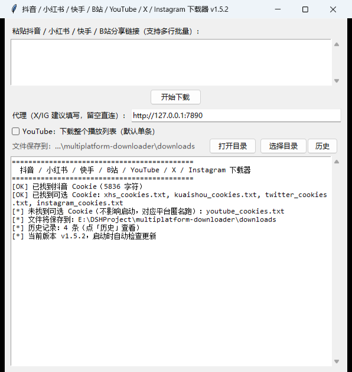

# multiplatform-downloader · Multi-Platform Watermark-Free Downloader

Paste a share link and download **watermark-free albums/images, Live Photos (still + motion mp4), and videos** from **Douyin / Xiaohongshu (RedNote) / Kuaishou**, **Bilibili videos** (BV/av numbers, b23.tv, auto-merged best quality + audio), **YouTube videos** (single video / playlist, auto-merged audio), **X (Twitter)** watermark-free single tweets, and **Instagram** watermark-free posts / Reels. Seven platforms, one window.

> A personal tool for **personal archiving & learning**. Respect creators' copyright — do not redistribute watermark-free content.

[](https://github.com/Janusilver/multiplatform-downloader/actions)
[](https://github.com/Janusilver/multiplatform-downloader/stargazers)
[](LICENSE)
[](https://www.python.org/)

**[中文文档](README.md)**

## 📸 Screenshots

| Main window | Download history |
|---|---|
|  |  |

## ✨ Features

| Platform | Content | Cookie needed |
|---|---|---|
| Douyin | Watermark-free album originals, Live Photos (jpg cover + mp4), watermark-free videos | ✅ required |
| Xiaohongshu | Watermark-free images, Live Photo mp4, videos (web streams may carry a 小红书号 watermark) | recommended (anonymous may be risk-blocked) |
| Kuaishou | Watermark-free videos, albums | recommended (works anonymously) |
| Bilibili | Video + audio auto-merged; bare BV number accepted | ❌ none |
| YouTube | Single video / Shorts / playlists; H.264 mp4 preferred, audio auto-merged | ❌ none for public videos (only members/age-restricted) |
| X (Twitter) | Single tweets (videos/images); naturally watermark-free | recommended (anonymous may hit the login wall) |
| Instagram | Post albums / Reels; naturally watermark-free (user-profile batches currently unavailable) | recommended (anonymous usually fails) |

- ✅ **Smart link detection**: paste whole share text; links are extracted and routed to the right platform automatically
- ✅ **Clipboard detection**: copy a link and the app auto-detects it — a hint bar appears above the input; one click adds it to the download queue
- ✅ **Download history**: every download recorded (time / platform / link / result); view via the "History" button; persisted to `history.json`
- ✅ **Auto-update check**: checks GitHub for new releases on startup; prompts to download when one is found
- ✅ **Batch download**: one link per line in a txt file; built-in throttling to avoid risk control
- ✅ Auto-retry on failure, Windows encoding handled

## 🚀 Windows exe (no Python required)

For people who don't want Python: **clone or download this repo, then double-click `release\多平台下载器.exe`**. The exe bundles Python, yt-dlp, curl_cffi and ffmpeg.

> ℹ️ The exe in `release\` is **v1.5.1** and covers all seven platforms (Douyin / Xiaohongshu / Kuaishou / Bilibili / YouTube / X / Instagram). The Douyin "browser fallback" parsing requires Chrome or Edge installed; if you see "browser exited right after launch", see the FAQ below.

**You need these files:**

| File | Purpose |
|---|---|
| `release\多平台下载器.exe` | Main program, double-click to run |
| `extensions\cookie-export\` | Browser extension: export Douyin / Xiaohongshu / Kuaishou / X / Instagram cookies (Bilibili needs none) |
| `douyin_cookies.txt` | Douyin cookie (**required**), placed next to the exe |
| `xhs_cookies.txt` | Xiaohongshu cookie (recommended), next to the exe |
| `kuaishou_cookies.txt` | Kuaishou cookie (recommended), next to the exe |
| `twitter_cookies.txt` | X cookie (recommended, login wall), next to the exe |
| `instagram_cookies.txt` | Instagram cookie (recommended, anonymous usually fails), next to the exe |
| `youtube_cookies.txt` | YouTube cookie (optional; public videos need none, only members / age-restricted) |

**First run (4 steps):**

1. **Install the extension**: Edge `edge://extensions/` (Chrome: `chrome://extensions/`) → enable "Developer mode" (bottom left) → "Load unpacked" → pick the `cookie-export` folder
2. **Export Douyin cookie** (required): open [douyin.com](https://www.douyin.com) logged in → click the extension icon → export → put `douyin_cookies.txt` next to the exe
3. **Export Xiaohongshu / Kuaishou cookies** (recommended): open logged-in [xiaohongshu.com](https://www.xiaohongshu.com) and [kuaishou.com](https://www.kuaishou.com), export each, same location
4. **Export X / Instagram cookies** (recommended when downloading X/IG): open logged-in [x.com](https://x.com) and [instagram.com](https://www.instagram.com), export each, same location
5. **Double-click the exe**: paste a link, click "开始下载"; files go to `downloads\`

> 💡 Bilibili only: no cookie at all. Douyin only: steps 1+2. Xiaohongshu/Kuaishou work without cookies but risk control is more likely.

**⚠️ Windows SmartScreen warning**: the exe is not code-signed — click "More info" → "Run anyway".

> Build it yourself: set up a venv + `ffmpeg\ffmpeg.exe` (see "Install" below), run `build.bat` → `dist\多平台下载器.exe` (~56 MB, 3–15 s startup unpacking is normal), auto-copied to `release\`.
>
> Or skip local builds: **push a `v*` tag or trigger it manually in the Actions tab** — [GitHub Actions](.github/workflows/build.yml) builds the exe and publishes a Release.

## 📦 Directory

```
multiplatform-downloader/
├── douyin.py            # Douyin core downloader
├── douyin_browser.py    # Douyin detail browser fallback (headless Chrome/Edge + CDP, stdlib only)
├── xhs.py               # Xiaohongshu downloader (curl_cffi Chrome impersonation)
├── kuaishou.py          # Kuaishou downloader (__APOLLO_STATE__ parsing)
├── twitter.py           # X downloader (yt-dlp wrapper)
├── youtube.py           # YouTube downloader (yt-dlp wrapper: single video / playlist)
├── instagram.py         # Instagram downloader (self-built private API, curl_cffi Chrome impersonation)
├── tests/test_urls.py   # URL-recognition unit tests (offline, plain asserts)
├── douyin.bat           # Douyin entry (double-click)
├── xhs.bat              # Xiaohongshu entry (double-click)
├── kuaishou.bat         # Kuaishou entry (double-click)
├── bilibili.bat         # Bilibili entry (double-click)
├── youtube.bat          # YouTube entry (double-click, optional whole playlist)
├── gui.py               # Seven-platform GUI (PyInstaller entry)
├── build.bat            # Build entry: installs deps + runs build.py
├── build.py             # PyInstaller script (filters out tcl interference)
├── .github/workflows/   # build.yml: auto-release; sync-meta.yml: fills Release notes
├── docs/                # Screenshots
├── LICENSE              # All rights reserved (personal use)
├── .gitignore           # Cookies / downloads / build artifacts excluded
├── release/
│   └── 多平台下载器.exe  # Ready-to-run exe
├── extensions/
│   └── cookie-export/   # Five-platform cookie export extension
├── douyin_cookies.txt   # [PRIVATE] Douyin cookie, gitignored
├── xhs_cookies.txt      # [PRIVATE] Xiaohongshu cookie, gitignored
├── kuaishou_cookies.txt # [PRIVATE] Kuaishou cookie, gitignored
├── downloads/           # Default save directory
└── ffmpeg/              # Portable ffmpeg (Bilibili merging)
```

## 🚀 Install (run from source)

Requirements: Python 3.10+, Windows / macOS / Linux.

```bash
# 1. venv (Windows)
python -m venv .venv
.venv\Scripts\activate

# macOS / Linux:
# python -m venv .venv && source .venv/bin/activate

# 2. deps (curl_cffi is used for Xiaohongshu/Kuaishou anti-risk-control)
pip install requests yt-dlp curl_cffi
```

**ffmpeg (Bilibili needs it)**: put `ffmpeg\ffmpeg.exe` in the project (or `pip install imageio-ffmpeg` and extract the exe from the package). Without ffmpeg only Bilibili fails.

**Chrome / Edge (Douyin needs one)**: the Douyin detail endpoint now requires a browser-made signature and refuses plain HTTP requests. The tool automatically fetches the detail once through your installed Chrome or Edge (headless, throwaway profile — your browser settings are untouched). No extra dependency, just have a browser installed.

## 📱 Douyin

### Step 1 (once): export the login cookie

Douyin's anti-bot requires a logged-in cookie:

1. Edge `edge://extensions/` (Chrome: `chrome://extensions/`) → enable "Developer mode" → "Load unpacked" → pick `extensions\cookie-export`
2. Open [douyin.com](https://www.douyin.com) logged in
3. Click the extension icon → "导出抖音 Cookie" → move `douyin_cookies.txt` to the project root

### Step 2: download

Double-click `douyin.bat` and paste a link, or CLI:

```bash
.venv\Scripts\python.exe douyin.py "https://v.douyin.com/xxxx/"
.venv\Scripts\python.exe douyin.py links.txt          # batch
.venv\Scripts\python.exe douyin.py "链接" -o 目录      # custom dir
```

Without `-o`, files save to the `downloads\` folder next to the script (independent of the working directory). Albums save to `downloads\作者_描述\01.jpg ...`; Live Photo albums get a numbered `.mp4` per image.

## 📕 Xiaohongshu

Supports `xhslink.com` short links, `explore/{id}`, `discovery/item/{id}`, `user/profile/{uid}/{id}`. Export `xhs_cookies.txt` first (anonymous works but may be risk-blocked into a 404 page).

```bash
.venv\Scripts\python.exe xhs.py "https://xhslink.com/xxxx/"
.venv\Scripts\python.exe xhs.py links.txt
```

- **Images**: original watermark-free via `imageList[].fileId` → `sns-img-bd.xhscdn.com` (older notes fall back to CDN token resolution)
- **Videos**: prefers the `originVideoKey` original file; as of 2026-08 most notes no longer expose it via the web, so it falls back to the highest-quality web stream (**may carry a 小红书号 watermark**, warned in the log)
- **Live Photos**: the embedded mp4 is downloaded for each image

## 🟠 Kuaishou

Supports `v.kuaishou.com` short links, `short-video/{id}`, `f/{id}`, `v.m.chenzhongtech.com/fw/photo/{id}`. Works anonymously; exporting `kuaishou_cookies.txt` is more stable.

```bash
.venv\Scripts\python.exe kuaishou.py "https://v.kuaishou.com/xxxx/"
.venv\Scripts\python.exe kuaishou.py links.txt
```

Videos auto-select the **best quality** (sorted by resolution + bitrate; H264 720p/3.4 Mbps and H265 720p/2 Mbps are both **watermark-free** — high-bitrate H264 wins). Albums use `ext_params.atlas`.

## 🎬 Bilibili

No cookie needed. Double-click `bilibili.bat` and paste:

- `BV19tge67EQ4` — **bare BV number works directly**
- `av123456`
- `b23.tv/xxxxx`
- Full URL `https://www.bilibili.com/video/BV...`

1080p / 4K need a premium account; free users get the best available quality, merged into one mp4 with ffmpeg.

## ▶️ YouTube

**A proxy is required** (YouTube is blocked in mainland China; the app reads the Windows system proxy automatically, or pass `--proxy http://127.0.0.1:7890`). Public videos need no cookie; members-only / age-restricted / private videos need `youtube_cookies.txt`.

```bash
.venv\Scripts\python.exe youtube.py "https://youtu.be/xxxx"                       # single
.venv\Scripts\python.exe youtube.py "https://www.youtube.com/watch?v=xxxx"        # single
.venv\Scripts\python.exe youtube.py "https://www.youtube.com/shorts/xxxx"         # Shorts
.venv\Scripts\python.exe youtube.py "https://www.youtube.com/playlist?list=PLxxx" # whole playlist
.venv\Scripts\python.exe youtube.py "https://www.youtube.com/watch?v=xxx&list=PLxxx" --playlist  # this playlist
```

How links are interpreted:

| Link form | Default behaviour |
|---|---|
| `youtu.be/ID`, `/shorts/ID`, `/live/ID`, `watch?v=ID` | single video |
| `watch?v=ID&list=PL…` | **current video only** (add `--playlist` for the whole list; the GUI has the matching checkbox) |
| `playlist?list=PL…` | whole playlist, capped at `--max 20` items, saved under `downloads/<playlist title>/` |
| `list=RD…` (auto-generated Mix/radio) | treated as a single video (endless stream) |
| `@channel`, `/channel/`, `/c/` | unsupported, clear message |

Quality prefers **H.264 + m4a** (best compatibility, usually up to 1080p) and merges to mp4 with ffmpeg; videos without H.264 fall back to best quality. `HTTP Error 403 Forbidden` means YouTube is throttling the current proxy exit IP — wait a few minutes / switch node / update yt-dlp (`pip install -U yt-dlp`) and retry.

## 🐦 X / 📷 Instagram

- **X**: via yt-dlp, supports **single tweets** (`/status/ID`); **user-profile batches are not supported** (yt-dlp has no X profile extractor). Media are original CDN links, **naturally watermark-free**.
- **Instagram**: self-built private API (curl_cffi Chrome TLS impersonation), supports **single items** (posts / Reels); albums / carousels **extract all media** (images + videos at once). ⚠️ **User-profile batch download is currently unavailable** (Instagram rate-limits the `web_profile_info` endpoint with 429, measured 2026-10); the tool prints a clear message.

```bash
.venv\Scripts\python.exe twitter.py "https://x.com/user/status/123"            # X single tweet
.venv\Scripts\python.exe instagram.py "https://www.instagram.com/p/CxAb12345/" # post (full album)
.venv\Scripts\python.exe instagram.py "https://www.instagram.com/reel/AbC/"    # Reels
.venv\Scripts\python.exe instagram.py "https://www.instagram.com/user/" --max 10  # profile batch (currently unavailable: IG 429)
```

> **Prereq**: X now needs a logged-in cookie (anonymous may hit the login wall); IG needs a login session (anonymous usually fails) — export `twitter_cookies.txt` / `instagram_cookies.txt` via the extension, placed next to the script / exe.
>
> **Proxy**: both platforms are hosted overseas; direct connections from China are unstable. The GUI "代理" box **auto-reads the Windows system proxy on startup** (auto-fills `127.0.0.1:7890` when Clash etc. has "system proxy" enabled) — editable / clearable; the CLI scripts auto-detect it too when `--proxy` is omitted. The four domestic platforms are unaffected and stay direct.

## ❓ FAQ

| Problem | Fix |
|---|---|
| Douyin "cookie expired / nothing parsed" | Re-export via the extension, overwrite `douyin_cookies.txt` |
| Douyin "browser exited right after launch" / no browser found | Douyin parsing needs Chrome or Edge installed. If it is installed and you still see this, security software is blocking "unknown app → launch browser". **With Kaspersky Free, adding the project folder to exclusions does not help** (no trusted-app whitelist in the free edition); the working fix is to **move the interpreter outside the project folder** — e.g. `copy .venv E:\venvs\multiplatform-downloader`, then run `E:\venvs\multiplatform-downloader\Scripts\python.exe douyin.py "url"`; or run Douyin with a system Python (Anaconda etc.). Other platforms never launch a browser, so they are unaffected |
| Xiaohongshu "note data fetch failed" | Bare `explore/{id}` links get risk-blocked — use a **share link** (has xsec_token, e.g. xhslink) or export `xhs_cookies.txt`; or the note is deleted |
| Kuaishou "no __APOLLO_STATE__" | Export `kuaishou_cookies.txt`; or the video is deleted |
| Xiaohongshu video has a 小红书号 watermark | The note has no original-file source; web streams carry it — platform behavior, not bypassable |
| Album images watermarked | Update to the latest version; new builds use watermark-free sources |
| Bilibili ffmpeg errors | Make sure `ffmpeg\ffmpeg.exe` exists (see Install) |
| YouTube returns `HTTP Error 403 Forbidden` | YouTube is throttling the current proxy exit IP — wait a few minutes / switch node / update yt-dlp (`pip install -U yt-dlp`); export `youtube_cookies.txt` for logged-in content. Note it **requires a proxy**; direct connections usually time out |
| YouTube link with `&list=` downloaded only one video | By default only the current video is fetched; add `--playlist` (or tick the GUI checkbox) / use a `playlist?list=` link for the whole list |
| exe won't start / keeps spinning | **First run** unpacks 55 MB + antivirus scans it — waiting 30–60 s is normal (busy cursor); subsequent runs take 3–15 s; check `error.log` next to the exe |
| Rebuilt after editing code, but startup still prompts to download an update | The check compares the **version baked into the exe vs the latest GitHub release tag**; if you changed code but didn't bump `APP_VERSION` (top of gui.py) before packaging, the exe is still behind and it will keep prompting. Always bump the version and tag when you repackage |
| X login wall / can't download | Export `twitter_cookies.txt`; X is hosted overseas — set a proxy via the GUI "代理" box or `--proxy http://127.0.0.1:7890` |
| Instagram download fails | Export `instagram_cookies.txt` (anonymous usually fails); overseas CDN needs a proxy, same as above. Single posts work; **profile batches have been rate-limited by Instagram (429) since 2026-10 — no known workaround yet** |
| Pasted a link but got "no XX link found" | For safety only **first-party platform hosts** are accepted (`v.douyin.com`, `xhslink.com`, `v.kuaishou.com` and the main site domains). An off-site link is rejected even if the text contains a platform domain as a substring — this keeps your login cookie from being sent to a third-party host. Short-link redirects also carry **no cookie** |

## ⚠️ Disclaimer

- Personal study & archiving only; **do not redistribute or commercialize watermark-free content**
- Respect creators and platform copyright; downloaded content is for personal use
- The tool depends on platform APIs, which may change; keep cookies private
